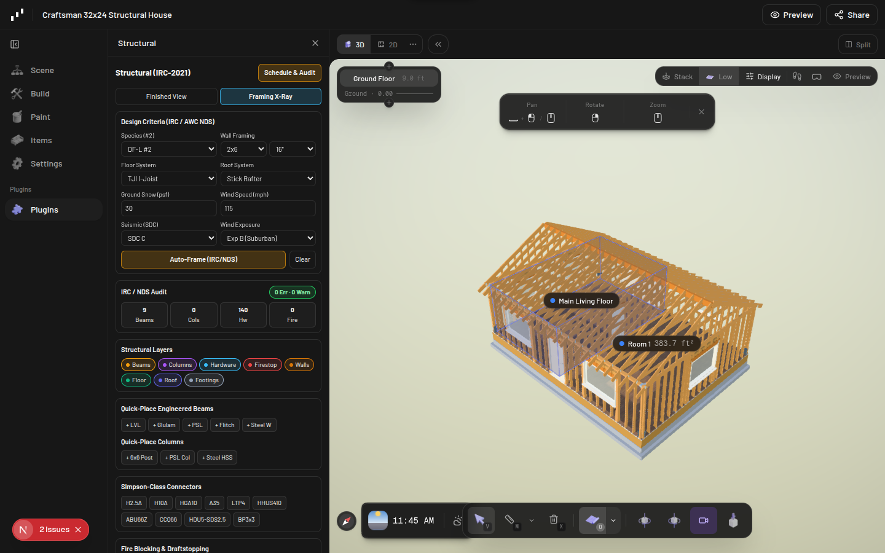
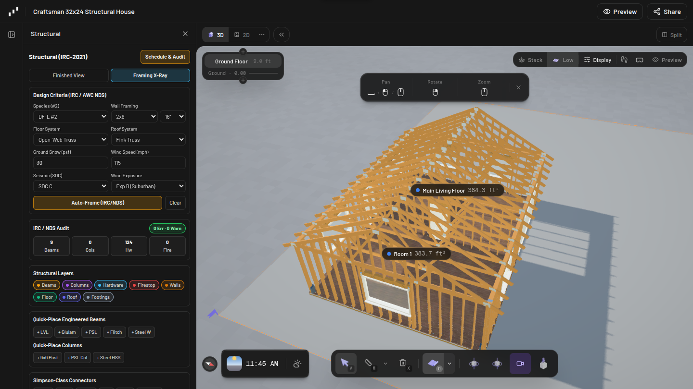
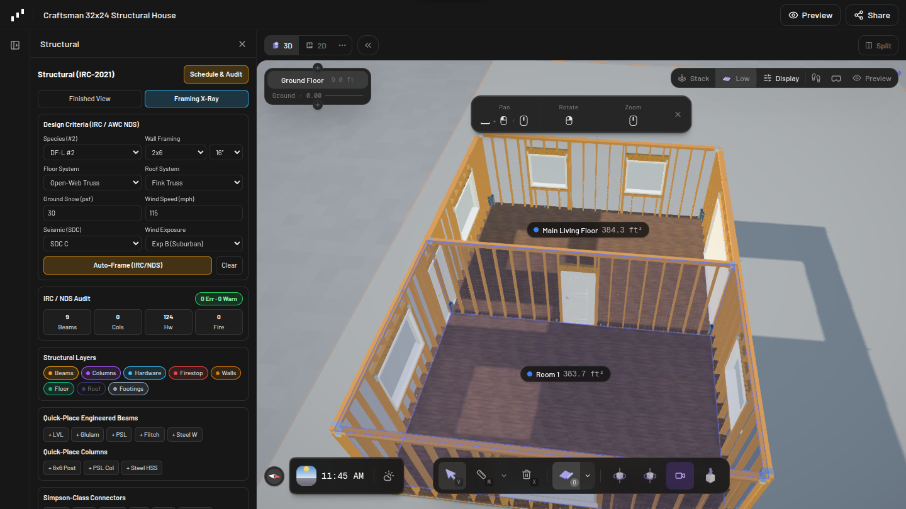

# Pascal Plugin Structural (`@kruschdev/pascal-plugin-structural`)

[](./LICENSE)
[](https://github.com/pascalorg/editor)
[](./docs/CAD-CATALOG.md)
[](./src/__tests__)

An open-source, MIT-licensed **Residential and Light-Commercial IRC / AWC NDS / WFCM / AISC Structural Framing** plugin for [Pascal Editor](https://github.com/pascalorg/editor) (`pluginId: krusch:structural`).

I built this as a standalone external plugin implementing Pascal's full Plugin API v1 and `E-016` agent contracts so it drops cleanly into any Pascal host without requiring upstream core merges. It anchors **Priority #1** in the 4-trade right-of-way hierarchy (`1. Structural -> 2. Plumbing -> 3. HVAC -> 4. Electrical`).

## Live Showcase in Pascal Editor







## Key Capabilities

1. **Multi-Species Dimensional Framing (`IRC 2021/2024` and `AWC NDS 2024`)**: Full span tables and NDS design values (`Fb`, `Fv`, `Fc`, `Fc_perp`, `E`, `Emin`, NDS Table 4A size factors `Cf`, and NDS 2024 Table 4B size-specific SYP `Fb` values) for **Douglas Fir-Larch #2**, **Spruce-Pine-Fir #2**, **Southern Yellow Pine #2**, and **Hem-Fir #2** across `12"`, `16"`, and `24"` OC framing, plus automatic `2x6` wet-wall upgrades near plumbing fixtures and wet rooms.
2. **Full-Building 3D `InstancedMesh` Framing Skeleton and Framing X-Ray**: Renders complete per-level structural skeletons in <= 8 batched draw calls (walls, framed door/window openings with zero studs piercing glass, TJI I-joists or Warren open-web floor trusses seated cleanly below slab soffits, stick rafters or Fink/Scissor/Attic roof trusses with exact point-to-point basis quaternions, continuous strip footings, and distributed Simpson-class hardware), paired with a one-click **Finished View | Framing X-Ray** toggle synced directly to Pascal's `wallMode`.
3. **Engineered Wood, Laminated Beams, and Structural Steel**: First-class `structural:beam` sizing and 3D CAD geometry for **Built-Up Dimensional**, **LSL 1.55E**, **LVL 2.0E 2600Fb** (1- to 4-ply), **PSL 2.0E Parallam**, **Glulam 24F-V4 / 24F-V8**, **A36 Flitch Beams**, and **A992 Steel W-Beams** (`W8x18` to `W14x30`), with multi-bay floor girder and cathedral ridge-beam splitting, ASD bending/shear checks, `L/360` and `L/240` deflection checks, bearing length (`IRC R502.6`), and exact jack-stud counts (`IRC R602.7`).
4. **47-SKU Simpson-Class Connector and Hardware Catalog**: Clean-room MIT galvanized-steel 3D CAD models and ASD uplift/download/lateral capacities across all 10 hardware families: **Hurricane Ties** (`H1`, `H2.5A`, `H10A`, `HGA10`, `MTS16`, `HTS20`), **Framing Angles and Clips** (`A35`, `A34`, `LTP4`, `L50`, `LS50`), **Joist and Beam Hangers** (`LUS26` to `LUS212`, `HUS210`, `LSSU210`, `IUS2.56/11.88`, `MIT411.88`, `HHUS210-2`, `HHUS410`, `HHUS5.50/10`, `HGUS5.50/12`, `HUCQ410-SDS`), **Post Bases and Caps** (`ABU44Z` to `ABU66Z`, `CB44`/`CB66`, `BC4`, `LPC4Z`/`LPC6Z`, `CCQ46`/`CCQ66`), **Hold-Downs and Straps** (`HDU2` to `HDU11`, `STHD14`, `LSTA24`, `MSTA36`, `MSTC40`, `CS16`, `CS-PF`), and **Seismic Anchorage** (`BP3x3` plate washers, `SSTB16` anchor bolts).
5. **Complete `IRC R302.11` Fire Blocking and `IRC R302.12` Draftstopping**: Derives, models, and audits all 8 code-mandated firestop planes: `10 ft` vertical stud cavities (`R302.11(2)`), furred walls (`R302.11(2)`), soffits and drop ceilings (`R302.11(1)`), stair stringers top and bottom (`R302.11(3)`), vertical chases and chimneys (`R302.11(4)`), MEP pipe/conduit/duct plate penetration collars (`R302.11(5)`), floor-ceiling draftstopping (`<= 1,000 sq ft`, `R302.12`), and attic draftstopping (`<= 3,000 sq ft`, `R302.12.1`).
6. **Continuous Load-Path Tracing and `IRC R602.10` Braced Wall Lines**: Traces gravity loads from beams through columns, TJI squash blocks, and spread pad footings (`IRC R403.1`), audits continuous wind/seismic uplift paths, and evaluates `R602.10` braced wall percentages with `CS-PF` portal and engineered shear-wall escalation.
7. **Priority #1 Cross-Trade Interop and Scope Notes**: Persists 5 clean scene-graph nodes (`structural:assembly`, `structural:beam`, `structural:column`, `structural:connector`, `structural:firestop`) so `@kruschdev/pascal-plugin-plumbing`, `@kruschdev/pascal-plugin-hvac`, and `@kruschdev/pascal-plugin-electrical` automatically snap to real studs, route around LVL/Glulam/steel beams and columns as inviolable no-bore keep-outs, and coordinate `R302.11(5)` penetration firestops with zero hard npm dependencies. `auditStructuralScene` enforces per-level beam and column MEP clashes directly (while stud `IRC R602.6` bore/notch rules and TJI web-hole clearances are checked by downstream MEP trade routers against published `structural:assembly` and `TJI_IJOIST_CATALOG` metadata). The priced BOM quantifies wall studs and plates, persisted beams, columns and spread pad footings, Simpson-class connectors, and firestop assemblies (excluding field floor joists, roof rafters/trusses, sheathing, and continuous strip footings).

## Documentation

| Guide | What It Covers |
|---|---|
| **[Architecture Guide](./docs/ARCHITECTURE.md)** | System layout, 5 entrypoint boundary gates, 5 `structural:*` node schemas, and parametric R3F instanced rendering |
| **[IRC / AWC NDS Reference](./docs/IRC-REFERENCE.md)** | Multi-species span tables, NDS ASD beam/column formulas, Simpson-class hardware selection, R302.11/R302.12 fire blocking, and R602.10 bracing |
| **[62-Model MIT 3D CAD Catalog](./docs/CAD-CATALOG.md)** | Full inventory of all 62 procedural `.glb` structural and hardware models and programmatic `./cad` builders |
| **[Agent Tools Reference (`E-016`)](./docs/AGENT-TOOLS.md)** | All 9 pure Zod agent tools and headless scene operations for MCP servers, chat workflows, and automation |

## Package Entrypoints

| Entrypoint | Export | Boundary Guarantee |
|---|---|---|
| `.` | `structuralPlugin`, `structuralHostPanel`, `structuralScheduleView`, `structuralChatExtension` | Full editor integration (`EditorHostPanel`, 7-tab `EditorHostView`, `InspectorExtension`, chat cards) |
| `./render` | `structuralRenderPlugin` | Editor-free read-only viewer manifest (verified by `bun run check:render`) |
| `./cad` | `STRUCTURAL_CAD_CATALOG`, `buildBuildingSkeletonGroup`, `buildBeamCad`, `buildConnectorCad`, `buildAssemblyPreviewCad` | Editor-free, React-free Three.js CAD builders for all 62 structural and connector models |
| `./irc` | Pure IRC/NDS sizing, auto-populate, audit, fire blocking, load-path, schedule, and BOM pricing functions | Framework-free TypeScript (zero React, Three.js, or `@pascal-app/*`) |
| `./agent-tools` | `structuralAgentTools` (`PluginAgentTools`, `E-016`) | Pure Zod-only contracts (`9` tools + skill) |
| `./agent-operations` | `structuralAgentOperations` (`AgentOperations`, `E-016`) | Pure headless scene operations with uniform `changes: { delete, create }` envelopes |

## Quick Start in a Pascal Host

```bash
npm install @kruschdev/pascal-plugin-structural
# or
bun add @kruschdev/pascal-plugin-structural
```

Register alongside the rest of the 4-trade suite (`structural`, `plumbing`, `hvac`, `electrical`):

```ts
import { extendPluginDiscovery } from '@pascal-app/core'
import { registerEditorHostPanel, registerEditorHostView } from '@pascal-app/editor'
import {
  structuralHostPanel,
  structuralPlugin,
  structuralScheduleView,
} from '@kruschdev/pascal-plugin-structural'

extendPluginDiscovery(async () => [structuralPlugin])
registerEditorHostPanel(structuralHostPanel)
registerEditorHostView(structuralScheduleView)
```

For read-only viewers (zero `@pascal-app/editor` bundle overhead):

```ts
import { setPluginDiscovery } from '@pascal-app/core'
import { structuralRenderPlugin } from '@kruschdev/pascal-plugin-structural/render'

setPluginDiscovery(async () => [structuralRenderPlugin])
```

## Development and Verification

```bash
bun install
bun run check          # tsc --noEmit + bun test src (52/52 tests) + 5/5 entry gates + dist/ build + Turbopack chunk gate
bun run export:cad     # Export all 62 clean-room .glb structural CAD models to assets/cad/
```

> **Engineering Disclaimer**: All IRC/AWC/NDS/AISC calculations, beam selections, connector schedules, fire-blocking audits, and BOM estimates in this plugin are deterministic drafting and pre-engineering aids and never substitute for a licensed Structural Engineer (SE/PE) stamp or local AHJ approval.

## License

MIT. Created by Kevin Ruschman ([@kruschdev](https://github.com/kruschdev)).
