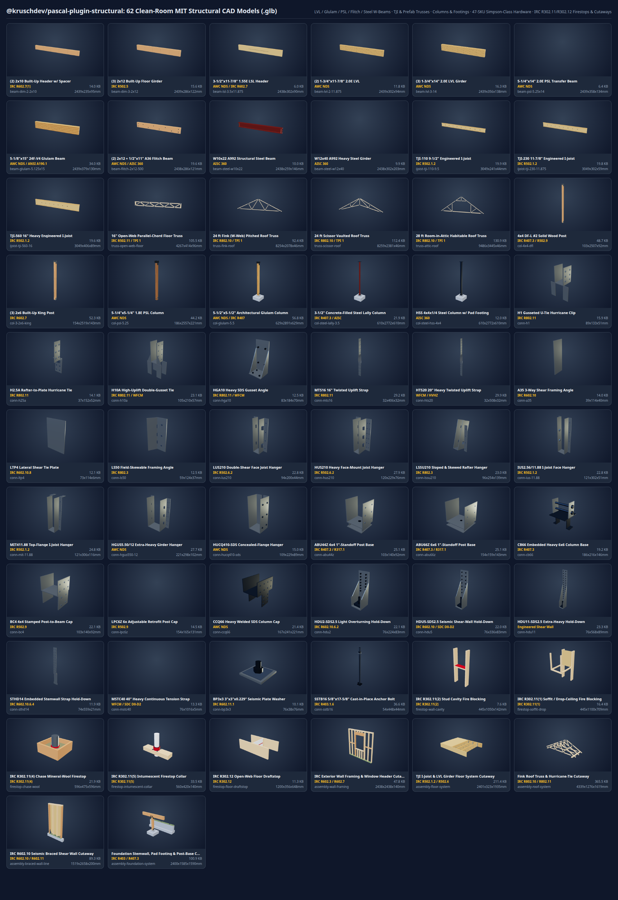

# 62-Model Clean-Room MIT Structural 3D CAD Library

Every structural beam, truss, column, Simpson-class connector, firestop, and framing cutaway in [`@kruschdev/pascal-plugin-structural/cad`](../src/cad/index.ts) is built procedurally from clean-room Three.js PBR geometry (MIT license, zero third-party meshes) and pre-exported to binary `.glb` + studio `.png` thumbnails in [`assets/cad/`](../assets/cad/catalog.json).



## Programmatic Usage (`./cad`)

```ts
import {
  STRUCTURAL_CAD_CATALOG,
  buildStructuralCadPart,
  buildBeamCad,
  buildConnectorCad,
  buildBuildingSkeletonGroup,
} from '@kruschdev/pascal-plugin-structural/cad'

// Build any of the 62 catalog models as a Three.js Group
const glulam = buildStructuralCadPart('beam-glulam-5.125x15')
const holdDown = buildConnectorCad({ sku: 'HDU5-SDS2.5' })
```

To regenerate all 62 `.glb` assets, `catalog.json`, thumbnails, and contact sheet after editing CAD geometry:

```bash
bun run export:cad
bun scripts/render-cad-thumbnails.ts
bun scripts/render-structural-cutaways.ts
```

## Complete 62-Model Catalog

### Engineered & Structural Beams (10)
| ID | Name | Dimensions (mm) | Code Ref |
|---|---|---|---|
| `beam-dim-2-2x10` | (2) 2x10 Built-Up Header w/ Spacer | `2439 x 235 x 95` | IRC R602.7(1) |
| `beam-dim-3-2x12` | (3) 2x12 Built-Up Floor Girder | `2439 x 286 x 122` | IRC R502.5 |
| `beam-lsl-3.5x11.875` | 3-1/2"x11-7/8" 1.55E LSL Header | `2438 x 302 x 90` | AWC NDS / IRC R602.7 |
| `beam-lvl-2-11.875` | (2) 1-3/4"x11-7/8" 2.0E LVL | `2439 x 302 x 94` | AWC NDS |
| `beam-lvl-3-14` | (3) 1-3/4"x14" 2.0E LVL Girder | `2439 x 356 x 138` | AWC NDS |
| `beam-psl-5.25x14` | 5-1/4"x14" 2.0E PSL Transfer Beam | `2439 x 358 x 134` | AWC NDS |
| `beam-glulam-5.125x15` | 5-1/8"x15" 24F-V4 Glulam Beam | `2439 x 379 x 130` | AWC NDS / ANSI A190.1 |
| `beam-flitch-2x12-500` | (2) 2x12 + 1/2"x11" A36 Flitch Beam | `2438 x 286 x 121` | AWC NDS / AISC 360 |
| `beam-steel-w10x22` | W10x22 A992 Structural Steel Beam | `2438 x 259 x 146` | AISC 360 |
| `beam-steel-w12x40` | W12x40 A992 Heavy Steel Girder | `2438 x 302 x 203` | AISC 360 |

### I-Joists & Prefabricated Trusses (7)
| ID | Name | Dimensions (mm) | Code Ref |
|---|---|---|---|
| `ijoist-tji-110-9.5` | TJI-110 9-1/2" Engineered I-Joist | `3049 x 241 x 44` | IRC R502.1.2 |
| `ijoist-tji-230-11.875` | TJI-230 11-7/8" Engineered I-Joist | `3049 x 302 x 59` | IRC R502.1.2 |
| `ijoist-tji-560-16` | TJI-560 16" Heavy Engineered I-Joist | `3049 x 406 x 89` | IRC R502.1.2 |
| `truss-open-web-floor` | 16" Open-Web Parallel-Chord Floor Truss | `4267 x 414 x 96` | IRC R502.11 / TPI 1 |
| `truss-fink-roof` | 24 ft Fink (W-Web) Pitched Roof Truss | `8254 x 2078 x 46` | IRC R802.10 / TPI 1 |
| `truss-scissor-roof` | 24 ft Scissor Vaulted Roof Truss | `8259 x 2381 x 46` | IRC R802.10 / TPI 1 |
| `truss-attic-roof` | 28 ft Room-in-Attic Habitable Roof Truss | `9486 x 3445 x 46` | IRC R802.10 / TPI 1 |

### Structural Columns & Footings (6)
| ID | Name | Dimensions (mm) | Code Ref |
|---|---|---|---|
| `col-4x4-dfl` | 4x4 DF-L #2 Solid Wood Post | `103 x 2507 x 92` | IRC R407.3 / R502.9 |
| `col-3-2x6-king` | (3) 2x6 Built-Up King Post | `154 x 2519 x 143` | IRC R602.7 |
| `col-psl-5.25` | 5-1/4"x5-1/4" 1.8E PSL Column | `186 x 2557 x 221` | AWC NDS |
| `col-glulam-5.5` | 5-1/2"x5-1/2" Architectural Glulam Column | `629 x 2891 x 629` | AWC NDS / IRC R407 |
| `col-steel-lally-3.5` | 3-1/2" Concrete-Filled Steel Lally Column | `610 x 2772 x 610` | IRC R407.3 / AISC |
| `col-steel-hss-4x4` | HSS 4x4x1/4 Steel Column w/ Pad Footing | `610 x 2772 x 610` | AISC 360 |

### Hurricane Ties & Framing Clips (9)
| ID | Name | Dimensions (mm) | Code Ref |
|---|---|---|---|
| `conn-h1` | H1 Gusseted U-Tie Hurricane Clip | `89 x 133 x 51` | IRC R802.11 |
| `conn-h25a` | H2.5A Rafter-to-Plate Hurricane Tie | `37 x 152 x 52` | IRC R802.11 |
| `conn-h10a` | H10A High-Uplift Double-Gusset Tie | `105 x 210 x 57` | IRC R802.11 / WFCM |
| `conn-hga10` | HGA10 Heavy SDS Gusset Angle | `83 x 184 x 70` | IRC R802.11 / WFCM |
| `conn-mts16` | MTS16 16" Twisted Uplift Strap | `32 x 406 x 32` | IRC R802.11 |
| `conn-hts20` | HTS20 20" Heavy Twisted Uplift Strap | `32 x 508 x 32` | WFCM / HVHZ |
| `conn-a35` | A35 3-Way Shear Framing Angle | `39 x 114 x 40` | IRC R602.10 |
| `conn-ltp4` | LTP4 Lateral Shear Tie Plate | `73 x 114 x 6` | IRC R602.10.8 |
| `conn-ls50` | LS50 Field-Skewable Framing Angle | `59 x 124 x 37` | IRC R802.3 |

### Joist & Engineered Beam Hangers (7)
| ID | Name | Dimensions (mm) | Code Ref |
|---|---|---|---|
| `conn-lus210` | LUS210 Double-Shear Face Joist Hanger | `94 x 200 x 44` | IRC R502.6.2 |
| `conn-hus210` | HUS210 Heavy Face-Mount Joist Hanger | `120 x 229 x 76` | IRC R502.6.2 |
| `conn-lssu210` | LSSU210 Sloped & Skewed Rafter Hanger | `96 x 254 x 139` | IRC R802.3 |
| `conn-ius-11.88` | IUS2.56/11.88 I-Joist Face Hanger | `121 x 302 x 51` | IRC R502.1.2 |
| `conn-mit-11.88` | MIT411.88 Top-Flange I-Joist Hanger | `121 x 306 x 116` | IRC R502.1.2 |
| `conn-hgus550-12` | HGUS5.50/12 Extra-Heavy Girder Hanger | `221 x 298 x 102` | AWC NDS |
| `conn-hucq410-sds` | HUCQ410-SDS Concealed-Flange Hanger | `109 x 229 x 89` | AWC NDS |

### Post Bases, Caps & Hold-Downs (13)
| ID | Name | Dimensions (mm) | Code Ref |
|---|---|---|---|
| `conn-abu44z` | ABU44Z 4x4 1"-Standoff Post Base | `103 x 140 x 92` | IRC R407.3 / R317.1 |
| `conn-abu66z` | ABU66Z 6x6 1"-Standoff Post Base | `154 x 159 x 143` | IRC R407.3 / R317.1 |
| `conn-cb66` | CB66 Embedded Heavy 6x6 Column Base | `186 x 216 x 146` | IRC R407.3 |
| `conn-bc4` | BC4 4x4 Stamped Post-to-Beam Cap | `103 x 140 x 92` | IRC R502.9 |
| `conn-lpc6z` | LPC6Z 6x Adjustable Retrofit Post Cap | `154 x 165 x 131` | IRC R502.9 |
| `conn-ccq66` | CCQ66 Heavy Welded SDS Column Cap | `167 x 241 x 221` | AWC NDS |
| `conn-hdu2` | HDU2-SDS2.5 Light Overturning Hold-Down | `76 x 224 x 83` | IRC R602.10.6.2 |
| `conn-hdu5` | HDU5-SDS2.5 Seismic Shear-Wall Hold-Down | `76 x 336 x 83` | IRC R602.10 / SDC D0-D2 |
| `conn-hdu11` | HDU11-SDS2.5 Extra-Heavy Hold-Down | `76 x 568 x 89` | Engineered Shear Wall |
| `conn-sthd14` | STHD14 Embedded Stemwall Strap Hold-Down | `74 x 559 x 21` | IRC R602.10.6.4 |
| `conn-mstc40` | MSTC40 40" Heavy Continuous Tension Strap | `76 x 1016 x 5` | WFCM / SDC D0-D2 |
| `conn-bp3x3` | BP3x3 3"x3"x0.229" Seismic Plate Washer | `76 x 38 x 76` | IRC R602.11.1 |
| `conn-sstb16` | SSTB16 5/8"x17-5/8" Cast-in-Place Anchor Bolt | `54 x 448 x 44` | IRC R403.1.6 |

### Fire Blocking & Assembly Cutaways (10)
| ID | Name | Dimensions (mm) | Code Ref |
|---|---|---|---|
| `firestop-wall-cavity` | IRC R302.11(2) Stud Cavity Fire Blocking | `445 x 1050 x 142` | IRC R302.11(2) |
| `firestop-soffit-drop` | IRC R302.11(1) Soffit / Drop-Ceiling Fire Blocking | `445 x 1100 x 709` | IRC R302.11(1) |
| `firestop-chase-wool` | IRC R302.11(4) Chase Mineral-Wool Firestop | `596 x 475 x 596` | IRC R302.11(4) |
| `firestop-intumescent-collar` | IRC R302.11(5) Intumescent Firestop Collar | `560 x 420 x 140` | IRC R302.11(5) |
| `firestop-floor-draftstop` | IRC R302.12 Open-Web Floor Draftstop | `1200 x 356 x 648` | IRC R302.12 |
| `assembly-wall-framing` | IRC Exterior Wall Framing & Window Header Cutaway | `2438 x 2438 x 140` | IRC R602.3 / R602.7 |
| `assembly-floor-system` | TJI I-Joist & LVL Girder Floor System Cutaway | `2401 x 323 x 1935` | IRC R502.1.2 / R502.6 |
| `assembly-roof-system` | Fink Roof Truss & Hurricane-Tie Cutaway | `4339 x 1276 x 1619` | IRC R802.10 / R802.11 |
| `assembly-braced-wall-line` | IRC R602.10 Seismic Braced Shear Wall Cutaway | `1519 x 2658 x 200` | IRC R602.10 / R602.11 |
| `assembly-foundation-system` | Foundation Stemwall, Pad Footing & Post-Base Cutaway | `2400 x 1585 x 1590` | IRC R403 / R407.3 |
